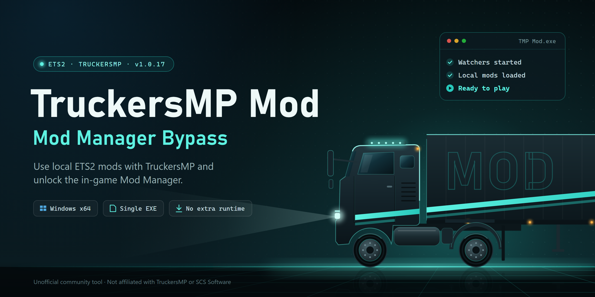

# TruckersMP Mod

### TruckersMP Mod Manager Bypass

Local mods and vehicle compatibility for Euro Truck Simulator 2.

Euro Truck Simulator 2 için yerel modlar ve araç uyumluluğu.

**[Download v1.0.30 / v1.0.30 indir](https://github.com/dmryasin-95/tmp-bypass-mod-manager/releases/download/v1.0.30/TMP.Mod.exe)**

[English](#english) · [Türkçe](#turkce)

---

## English

TruckersMP Mod is a desktop launcher for using local ETS2 mods with TruckersMP and accessing the in-game Mod Manager.

Download stable **v1.0.30** from [Releases](https://github.com/dmryasin-95/tmp-bypass-mod-manager/releases/latest). Save `TMP.Mod.exe` as `TMP Mod.exe`, or extract `TMP-Mod-1.0.30.zip`. Both contain the same application. A [repository copy](TMP%20Mod.exe) is also available. No separate compatibility mod is required.

### What changed since v1.0.17

- Added truck, bus and car choices for how unsupported mod vehicles appear to other players.
- Fixed missing dealer brands and incorrect brand/vehicle associations in the tested mod setup.
- Fixed the crash when returning to the dealer after configuring a vehicle. Two consecutive configuration/return cycles passed the user's live test in v1.0.29; v1.0.30 keeps that fix.
- Preparation reuses its cache across launches. Measured compiled runs prepared unchanged mod content in about 13–15 seconds. Adding or changing mods requires another scan and can take longer.
- v1.0.30 adds an explanation above the vehicle choices: stock vehicles keep their own make and model.

Compatible accessory database (ADB) updates are still detected automatically. If the database changes during or after preparation, prepare a new session. A different database format or changed game/TruckersMP code signatures may require an application update.

### How the three vehicle choices work

Choose **Karşı tarafta görünen araç** before starting the watchers. This sets the network representation of an unsupported local mod vehicle. You continue to see your own mod's model and interior; other players see the selected supported vehicle.

| Choice in the application | Other players see |
| --- | --- |
| **Tır · Volvo FH16** | Volvo FH16 (`volvo.fh16_2012`) |
| **Otobüs · TruckersMP** | The supported TruckersMP bus (`t16shd`) |
| **Araba · Scout** | Scout / Škoda Superb (`skoda.superb`) |

For example, choose **Araba · Scout** for a car mod to represent it as a Scout, or **Otobüs · TruckersMP** for a bus mod to represent it as the supported bus. This choice applies to unsupported mod vehicles throughout that session; it does not automatically switch based on the type of each mod. Start a new session to change it.

**Stock ETS2 vehicles keep their own make and model.** A stock Scania stays a Scania even with Volvo selected. Vehicles already recognized by TruckersMP also keep their supported identity. The choice does not grant access to restricted vehicles or parts; client and server rules still apply. Compatibility depends on the mod's definitions and dependencies.

### Requirements

| Component | Requirement |
| --- | --- |
| Operating system | 64-bit Windows |
| Game | Installed ETS2; tested build: **1.61.1.9s** |
| Multiplayer | Installed official TruckersMP launcher; local core version: **0.7.8.3** |
| Permissions | Run `TMP Mod.exe` as administrator |
| Extra installation | No additional runtime installation required |

### Install and start

1. Close ETS2 and any older TMP Mod windows before preparing a new session.
2. Place `TMP Mod.exe` in `%APPDATA%\TruckersMP`.
3. Right-click `TMP Mod.exe`, select **Run as administrator** and approve the Windows prompt. Then choose the vehicle appearance described above.
4. Click **İzleyicileri başlat** (Start watchers).
5. Wait for **OYNA için hazır** (Ready to play).
6. Click **TruckersMP’yi aç**, then press **PLAY / OYNA** in the official TruckersMP launcher.
7. Select your mods and vehicle in the game.

Closing the TMP Mod window leaves an active adaptation running. Exit the game to end that session. **Beklemeyi iptal et** cancels waiting before the game starts. Use **Günlükleri aç** to inspect a failed run.

### Checks and troubleshooting

The unchanged runtime carries 19 passing dealer/transaction test groups, 54 controller tests and 42 native scenarios. The v1.0.30 interface selection/locking checks and compiled package checks passed. The user confirmed correct dealer associations and two successful configuration returns in v1.0.29. These results cover the tested setup; they do not establish compatibility with every mod or acceptance by every multiplayer server.

| Symptom | Next step |
| --- | --- |
| The game is already running | Close ETS2, start the watchers, then launch a new session. |
| Preparation takes longer after changing mods | Allow the content scan to finish; later launches can reuse the cache. |
| The database changed after preparation | Prepare a new session. |
| You want a different appearance for a mod | Exit the game and choose truck, bus or car before starting new watchers. |
| Preparation fails, a brand is missing or the game closes | Confirm **v1.0.30**, open the logs and report the mod name and the step that failed. |
| A game or TruckersMP update changes the database format or code signatures | Check for a newer application version and report the error message. |

---

## Türkçe

TruckersMP Mod, yerel ETS2 modlarını TruckersMP ile kullanmak ve oyun içindeki Mod Yöneticisi'ne erişmek için hazırlanmış bir masaüstü başlatıcısıdır.

Kararlı **v1.0.30** sürümünü [Releases](https://github.com/dmryasin-95/tmp-bypass-mod-manager/releases/latest) bölümünden indir. `TMP.Mod.exe` dosyasını `TMP Mod.exe` adıyla kaydet veya `TMP-Mod-1.0.30.zip` arşivini aç. İkisinde de aynı uygulama bulunur. [Depodaki kopya](TMP%20Mod.exe) da kullanılabilir. Ayrı bir uyumluluk modu kurman gerekmez.

### v1.0.17'den bu yana değişenler

- Desteklenmeyen modlu araçların diğer oyunculara görünümü için tır, otobüs ve araba seçenekleri eklendi.
- Test edilen mod kurulumunda eksik bayi markaları ve yanlış marka/araç eşleşmeleri düzeltildi.
- Aracı yapılandırıp bayiye geri dönünce oluşan kapanma düzeltildi. Kullanıcı v1.0.29'da iki yapılandırma/dönüş işlemini arka arkaya sorunsuz tamamladı; v1.0.30 bu düzeltmeyi korur.
- Hazırlık önbelleği sonraki açılışlarda tekrar kullanılıyor. Ölçülen derlenmiş uygulama denemelerinde aynı mod içeriği yaklaşık 13–15 saniyede hazırlandı. Mod eklemek veya değiştirmek yeniden tarama gerektirir ve daha uzun sürebilir.
- v1.0.30'da araç seçeneklerinin üstüne, oyunun kendi araçlarının kendi marka ve modeliyle göründüğünü açıklayan metin eklendi.

Uyumlu aksesuar veri tabanı (ADB) güncellemeleri otomatik algılanmaya devam eder. Veri tabanı hazırlık sırasında veya sonrasında değişirse yeni oturum hazırla. Veri tabanı biçimi ya da oyun/TruckersMP kod imzaları değişirse uygulama güncellemesi gerekebilir.

### Üç araç görünümü seçeneği nasıl çalışır?

İzleyicileri başlatmadan önce **Karşı tarafta görünen araç** seçimini yap. Bu seçim, desteklenmeyen yerel modlu aracın diğer oyunculara hangi araç olarak gönderileceğini belirler. Sen kendi modunun modelini ve iç mekânını görmeye devam edersin; diğer oyuncular seçtiğin desteklenen aracı görür.

| Uygulamadaki seçenek | Diğer oyuncuların gördüğü araç |
| --- | --- |
| **Tır · Volvo FH16** | Volvo FH16 (`volvo.fh16_2012`) |
| **Otobüs · TruckersMP** | Desteklenen TruckersMP otobüsü (`t16shd`) |
| **Araba · Scout** | Scout / Škoda Superb (`skoda.superb`) |

Örneğin bir araba modunun karşı tarafta Scout görünmesi için **Araba · Scout**, otobüs modunun desteklenen otobüs olarak görünmesi için **Otobüs · TruckersMP** seçebilirsin. Seçim, o oturumdaki desteklenmeyen modlu araçlara uygulanır; her modun türüne göre kendiliğinden değişmez. Seçimi değiştirmek için yeni oturum başlat.

**Oyunun kendi vanilla araçları kendi marka ve modeliyle görünür.** Volvo seçili olsa da vanilla Scania, Scania olarak kalır. TruckersMP'nin zaten tanıdığı araçlar da desteklenen kimliklerini korur. Bu seçim, kısıtlı araç veya parçalara erişim yetkisi vermez; istemci ve sunucu kuralları uygulanmaya devam eder. Uyumluluk, modun tanımlarına ve bağımlılıklarına bağlıdır.

### Gereksinimler

| Bileşen | Gereksinim |
| --- | --- |
| İşletim sistemi | 64-bit Windows |
| Oyun | Kurulu ETS2; test edilen sürüm: **1.61.1.9s** |
| Çok oyunculu | Kurulu resmî TruckersMP başlatıcısı; yerel core sürümü: **0.7.8.3** |
| Yetki | `TMP Mod.exe` yönetici olarak çalıştırılmalı |
| Ek kurulum | Ek çalışma ortamı kurulumu gerekmez |

### Kurulum ve kullanım

1. Yeni oturum hazırlamadan önce ETS2'yi ve eski TMP Mod pencerelerini kapat.
2. `TMP Mod.exe` dosyasını `%APPDATA%\TruckersMP` klasörüne yerleştir.
3. `TMP Mod.exe` dosyasına sağ tıkla, **Yönetici olarak çalıştır** seçeneğini seç ve Windows izin penceresini onayla. Ardından yukarıda açıklanan araç görünümünü seç.
4. **İzleyicileri başlat** düğmesine bas.
5. **OYNA için hazır** durumunu bekle.
6. **TruckersMP’yi aç** düğmesine bas, ardından resmî başlatıcıda **OYNA** seçeneğini kullan.
7. Modlarını ve aracını oyundan seç.

TMP Mod penceresini kapatmak etkin uyarlamayı durdurmaz. Oturumu bitirmek için oyundan çık. **Beklemeyi iptal et**, oyun başlamadan önce beklemeyi iptal eder. Başarısız bir çalıştırmayı incelemek için **Günlükleri aç** düğmesini kullan.

### Kontroller ve sorun giderme

Değişmeyen çalışma kodu için 19 bayi/işlem test grubu, 54 controller testi ve 42 native senaryo geçti. v1.0.30'un arayüz seçim/kilitleme ve derlenmiş paket kontrolleri de başarılı. Kullanıcı v1.0.29'da bayi eşleşmelerini ve iki yapılandırma dönüşünü doğruladı. Bu sonuçlar test edilen kurulumu kapsar; tüm modların uyumluluğunu veya her çok oyunculu sunucunun kabulünü doğrulamaz.

| Durum | Yapılacak işlem |
| --- | --- |
| Oyun zaten açık | ETS2'yi kapat, izleyicileri başlat ve yeni bir oyun oturumu aç. |
| Mod değişikliğinden sonra hazırlık uzun sürüyor | İçerik taramasının tamamlanmasını bekle; sonraki açılışlar önbelleği kullanabilir. |
| Hazırlıktan sonra veri tabanı değişti | Yeni oturum hazırla. |
| Modun karşı taraftaki görünümünü değiştirmek istiyorsun | Oyundan çık ve yeni izleyicileri başlatmadan önce tır, otobüs veya araba seç. |
| Hazırlık başarısız, marka eksik veya oyun kapanıyor | **v1.0.30** kullandığını kontrol et; günlüklerle birlikte modun adını ve hatanın oluştuğu adımı bildir. |
| Oyun veya TruckersMP güncellemesi veri tabanı biçimini ya da kod imzalarını değiştirdi | Yeni uygulama sürümünü kontrol et ve hata mesajını bildir. |

---

## File integrity / Dosya bütünlüğü

**TruckersMP Mod 1.0.30** · **9,837,568 bytes / bayt**

EXE SHA-256:

~~~text
24ddbb7edbeae20933be3af67f6010fc15ebaa23bb6aec7f23910ee9947b13e8
~~~

ZIP SHA-256 (`TMP-Mod-1.0.30.zip`, 9,726,844 bytes / bayt):

~~~text
29cb07cc5a2386709f91fd25b3cdaa001b2624fcf6229875cd5f209e99559ddc
~~~

~~~powershell
Get-FileHash -LiteralPath '.\TMP Mod.exe' -Algorithm SHA256
~~~

**Contact / İletişim:** Discord: **yasindemir**
